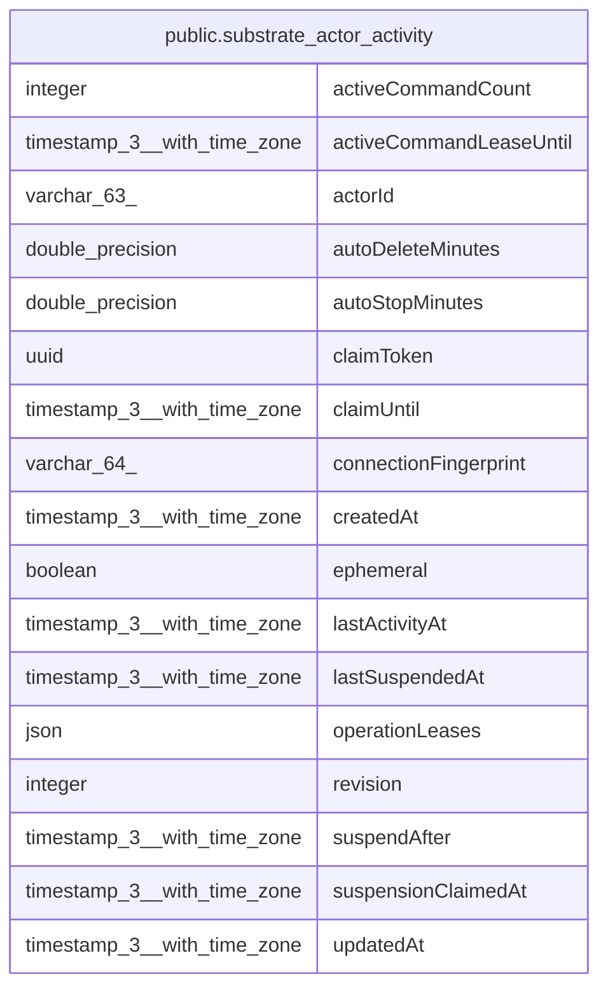

# public.substrate_actor_activity

## Columns

| Name | Type | Default | Nullable | Children | Parents | Comment |
| ---- | ---- | ------- | -------- | -------- | ------- | ------- |
| activeCommandCount | integer | 0 | false |  |  |  |
| activeCommandLeaseUntil | timestamp(3) with time zone |  | true |  |  |  |
| actorId | varchar(63) |  | false |  |  |  |
| autoDeleteMinutes | double precision |  | false |  |  |  |
| autoStopMinutes | double precision |  | false |  |  |  |
| claimToken | uuid |  | true |  |  | Unique owner of a suspend or delete claim. |
| claimUntil | timestamp(3) with time zone |  | true |  |  |  |
| connectionFingerprint | varchar(64) |  | false |  |  |  |
| createdAt | timestamp(3) with time zone | CURRENT_TIMESTAMP(3) | false |  |  |  |
| ephemeral | boolean | false | false |  |  |  |
| lastActivityAt | timestamp(3) with time zone |  | false |  |  |  |
| lastSuspendedAt | timestamp(3) with time zone |  | true |  |  |  |
| operationLeases | json | '{}'::json | false |  |  | Operation IDs mapped to lease expiry times in Unix milliseconds. |
| revision | integer | 0 | false |  |  | Compare-and-set revision for Actor lifecycle changes. |
| suspendAfter | timestamp(3) with time zone |  | true |  |  |  |
| suspensionClaimedAt | timestamp(3) with time zone |  | true |  |  |  |
| updatedAt | timestamp(3) with time zone | CURRENT_TIMESTAMP(3) | false |  |  |  |

## Constraints

| Name | Type | Definition |
| ---- | ---- | ---------- |
| PK_40426ea42a2c93d4637dbb83c19 | PRIMARY KEY | PRIMARY KEY ("actorId") |
| substrate_actor_activity_activeCommandCount_not_null | n | NOT NULL "activeCommandCount" |
| substrate_actor_activity_actorId_not_null | n | NOT NULL "actorId" |
| substrate_actor_activity_autoDeleteMinutes_not_null | n | NOT NULL "autoDeleteMinutes" |
| substrate_actor_activity_autoStopMinutes_not_null | n | NOT NULL "autoStopMinutes" |
| substrate_actor_activity_connectionFingerprint_not_null | n | NOT NULL "connectionFingerprint" |
| substrate_actor_activity_createdAt_not_null | n | NOT NULL "createdAt" |
| substrate_actor_activity_ephemeral_not_null | n | NOT NULL ephemeral |
| substrate_actor_activity_lastActivityAt_not_null | n | NOT NULL "lastActivityAt" |
| substrate_actor_activity_operationLeases_not_null | n | NOT NULL "operationLeases" |
| substrate_actor_activity_revision_not_null | n | NOT NULL revision |
| substrate_actor_activity_updatedAt_not_null | n | NOT NULL "updatedAt" |

## Indexes

| Name | Definition |
| ---- | ---------- |
| IDX_b9f462e07ded43a0b710a117ab | CREATE INDEX "IDX_b9f462e07ded43a0b710a117ab" ON public.substrate_actor_activity USING btree ("connectionFingerprint", "lastActivityAt") |
| PK_40426ea42a2c93d4637dbb83c19 | CREATE UNIQUE INDEX "PK_40426ea42a2c93d4637dbb83c19" ON public.substrate_actor_activity USING btree ("actorId") |

## Relations

---

> Generated by [tbls](https://github.com/k1LoW/tbls)
