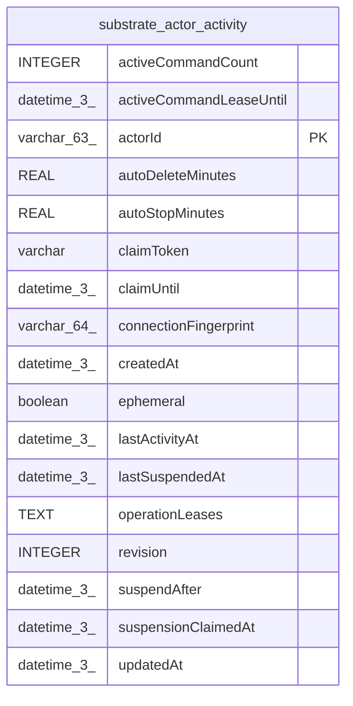

# substrate_actor_activity

## Description

<details>
<summary><strong>Table Definition</strong></summary>

```sql
CREATE TABLE "substrate_actor_activity" ("actorId" varchar(63) PRIMARY KEY NOT NULL, "connectionFingerprint" varchar(64) NOT NULL, "lastActivityAt" datetime(3) NOT NULL, "lastSuspendedAt" datetime(3), "autoStopMinutes" real NOT NULL, "autoDeleteMinutes" real NOT NULL, "ephemeral" boolean NOT NULL DEFAULT (false), "createdAt" datetime(3) NOT NULL DEFAULT (STRFTIME('%Y-%m-%d %H:%M:%f', 'NOW')), "updatedAt" datetime(3) NOT NULL DEFAULT (STRFTIME('%Y-%m-%d %H:%M:%f', 'NOW')), "suspensionClaimedAt" datetime(3), "activeCommandCount" integer NOT NULL DEFAULT (0), "activeCommandLeaseUntil" datetime(3), "revision" integer NOT NULL DEFAULT (0), "operationLeases" text NOT NULL DEFAULT ('{}'), "suspendAfter" datetime(3), "claimToken" varchar, "claimUntil" datetime(3))
```

</details>

## Columns

| Name | Type | Default | Nullable | Children | Parents | Comment |
| ---- | ---- | ------- | -------- | -------- | ------- | ------- |
| activeCommandCount | INTEGER | 0 | false |  |  |  |
| activeCommandLeaseUntil | datetime(3) |  | true |  |  |  |
| actorId | varchar(63) |  | false |  |  |  |
| autoDeleteMinutes | REAL |  | false |  |  |  |
| autoStopMinutes | REAL |  | false |  |  |  |
| claimToken | varchar |  | true |  |  |  |
| claimUntil | datetime(3) |  | true |  |  |  |
| connectionFingerprint | varchar(64) |  | false |  |  |  |
| createdAt | datetime(3) | STRFTIME('%Y-%m-%d %H:%M:%f', 'NOW') | false |  |  |  |
| ephemeral | boolean | false | false |  |  |  |
| lastActivityAt | datetime(3) |  | false |  |  |  |
| lastSuspendedAt | datetime(3) |  | true |  |  |  |
| operationLeases | TEXT | '{}' | false |  |  |  |
| revision | INTEGER | 0 | false |  |  |  |
| suspendAfter | datetime(3) |  | true |  |  |  |
| suspensionClaimedAt | datetime(3) |  | true |  |  |  |
| updatedAt | datetime(3) | STRFTIME('%Y-%m-%d %H:%M:%f', 'NOW') | false |  |  |  |

## Constraints

| Name | Type | Definition |
| ---- | ---- | ---------- |
| actorId | PRIMARY KEY | PRIMARY KEY (actorId) |
| sqlite_autoindex_substrate_actor_activity_1 | PRIMARY KEY | PRIMARY KEY (actorId) |

## Indexes

| Name | Definition |
| ---- | ---------- |
| IDX_b9f462e07ded43a0b710a117ab | CREATE INDEX "IDX_b9f462e07ded43a0b710a117ab" ON "substrate_actor_activity" ("connectionFingerprint", "lastActivityAt")  |
| sqlite_autoindex_substrate_actor_activity_1 | PRIMARY KEY (actorId) |

## Relations



---

> Generated by [tbls](https://github.com/k1LoW/tbls)
